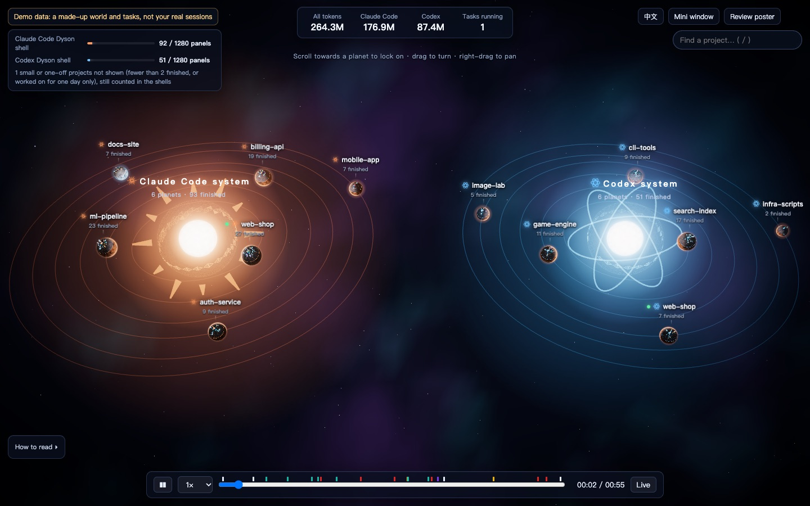
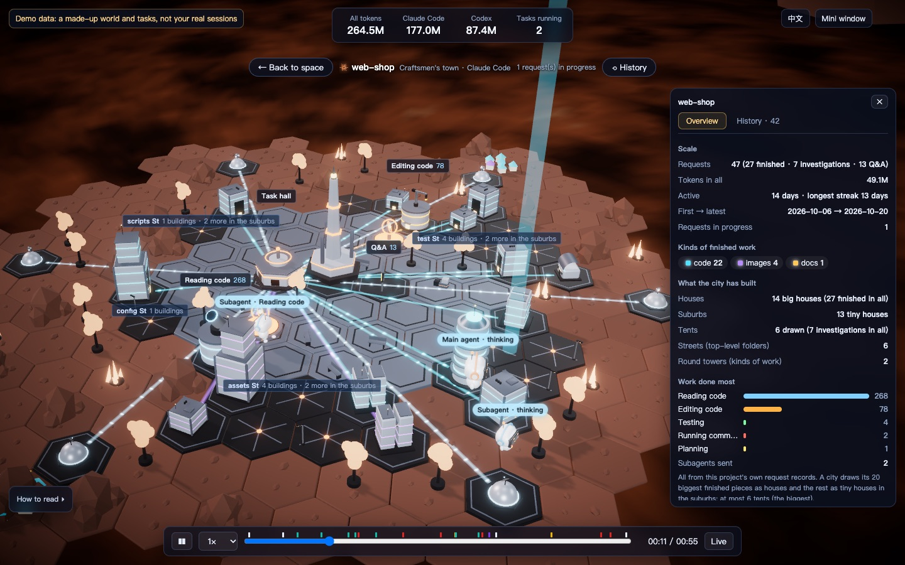

# Agent Universe

**Watch your Claude Code and Codex work grow into a universe.**

[中文说明](https://github.com/dong845/agent-universe-plugin/blob/main/docs/README.zh.md)



Agent Universe reads the logs Claude Code and Codex already keep on your computer and turns them into a
living 3D world: every project is a planet, every finished piece of work a building, and the agents
working right now are little robots you can follow. Nothing leaves your machine.

```
npx agent-universe
```

It opens http://127.0.0.1:5182/. Needs Node 22.18 or newer, on macOS or Linux.



## What you get

- **Everything at a glance.** One star per agent; a planet per project, bigger the more it produced;
  every finished piece lights a panel of the star's Dyson shell.
- **Fly into any project.** Its city shows what was built and what kind of work it took, with an
  overview of its size. Rename, hide or merge planets as you like.
- **Agents, live.** The main agent and its subagents walk, think, wait for you and celebrate. Click one
  and the camera follows it.
- **Never miss a waiting session.** "Needs you" lists sessions waiting for an approval or an answer,
  with macOS notifications. With the optional hook you answer Claude Code right in the page.
- **Rewind.** Step through a project's history, or replay any request.
- **Share safely.** A review poster, an MP4/GIF replay or an offline HTML page — request titles hidden,
  paths never included.

Also: English and Chinese, an always-on-top mini window (Chrome/Edge), a guided tour on the first visit.

## Private by design

- Its data comes from the logs in `~/.claude/projects` and `~/.codex/sessions`, read-only.
- The server listens on 127.0.0.1 and sends nothing anywhere. Its own files (cache, settings) live in
  `~/.agent-town/`. To remove it, switch off any hooks in Settings, then delete that folder.
- No logs yet? You get a demo world to look around.

## More ways to run it

```
npx agent-universe --port 5190 --no-open    # another port, don't open the browser
```

In Claude Code, install the plugin and type `/agent-universe`:

```
/plugin marketplace add dong845/agent-universe-plugin
/plugin install agent-universe@agent-universe
```

Claude's and OpenAI's logos are not bundled; Settings (⚙) can download them for display on your machine
only.

## Development

```
git clone <this repository> agent-universe && cd agent-universe
npm start             # installs, builds the page, starts the server
node --run dev        # Vite dev server on 5180
node --run test       # unit tests
node --run e2e        # browser tests
node scripts/pack.mjs --check   # build the npm package, install it and run it
```

Design notes: [docs/decisions.md](docs/decisions.md). License: MIT.
