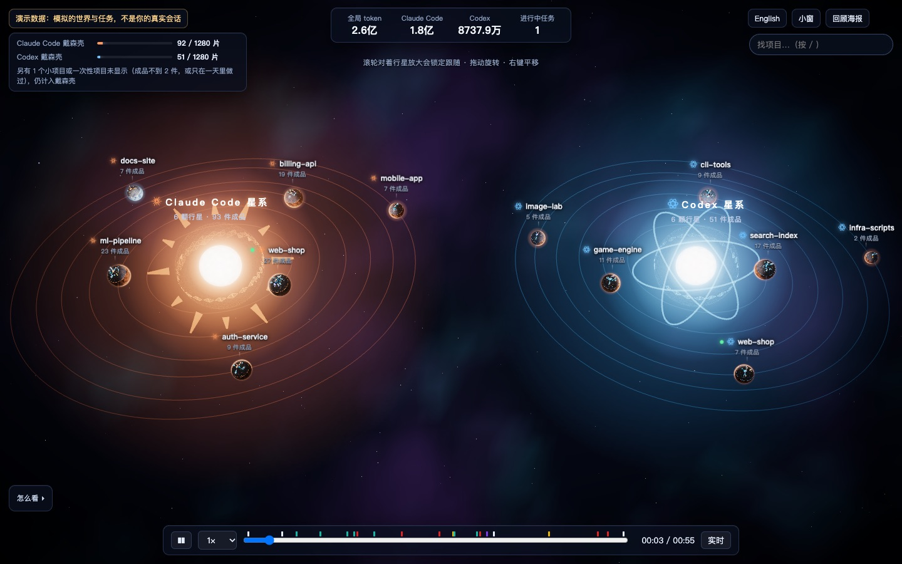
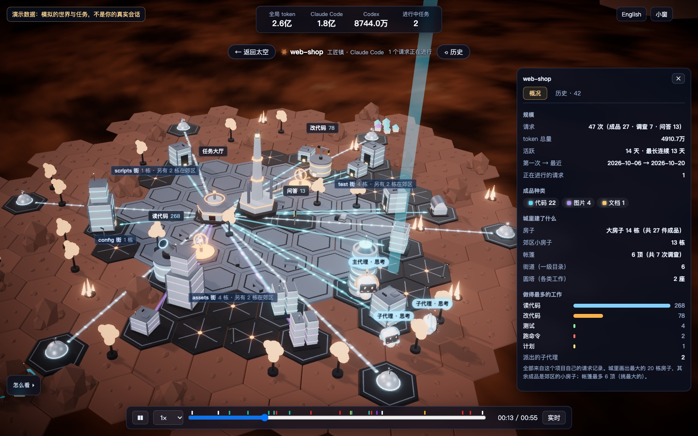

# Agent Universe · 智能体宇宙

**看你和 Claude Code、Codex 一起做的事，长成一个宇宙。**

[English](https://www.npmjs.com/package/agent-universe)



Agent Universe 读取 Claude Code 和 Codex 本来就存在你电脑上的日志，把它们变成一个会动的 3D 世界：
每个项目是一颗行星，每件做完的成品是一栋建筑，正在干活的代理是一个个可以跟着看的小机器人。
所有数据都不离开你的电脑。

```
npx agent-universe
```

会打开 http://127.0.0.1:5182/。需要 Node 22.18 或更新，macOS 或 Linux。



## 能看到什么

- **一眼看全局。** 每种代理一颗恒星；每个项目一颗行星，做得越多越大；每件成品点亮恒星戴森壳上的一片。
- **飞进任何项目。** 它的城市展示做出了什么、花在哪类工作上，还有项目规模的概况。行星可以改名、隐藏或合并。
- **实时看代理干活。** 主代理和子代理会走动、思考、等你、庆祝；点一下，镜头就跟着它。
- **不错过等你的会话。** 「需要你」列出等你批准或回答的会话，并发 macOS 通知；装上可选的 hook，
  还能直接在页面上回答 Claude Code。
- **回看历史。** 按步骤回到项目的任何时刻，或重放任意一次请求。
- **放心分享。** 回顾海报、MP4/GIF 回放、离线 HTML 页面——隐藏请求标题，从不包含路径。

另外：中文和英文界面、置顶小窗（Chrome/Edge）、第一次打开时的引导。

## 隐私

- 数据来自 `~/.claude/projects` 和 `~/.codex/sessions` 里的日志，只读不改。
- 服务只监听 127.0.0.1，不向任何地方发送数据。它自己的文件（缓存、设置）在 `~/.agent-town/`。要卸载：先在设置里关掉 hook，再删掉这个文件夹。
- 还没有日志？会先看到一个演示世界。

## 其他用法

```
npx agent-universe --port 5190 --no-open    # 换端口，不自动打开浏览器
```

在 Claude Code 里装插件后，输入 `/agent-universe` 打开：

```
/plugin marketplace add dong845/agent-universe-plugin
/plugin install agent-universe@agent-universe
```

Claude 和 OpenAI 的官方标志不随包提供；可以在设置（⚙）里下载，只在你的电脑上显示。

## 开发

```
git clone <这个仓库> agent-universe && cd agent-universe
npm start             # 安装依赖、构建页面、启动服务
node --run dev        # Vite 开发服务器（5180 端口）
node --run test       # 单元测试
node --run e2e        # 浏览器测试
node scripts/pack.mjs --check   # 构建 npm 包、安装并运行它
```

设计记录：[docs/decisions.md](docs/decisions.md)。许可证：MIT。
